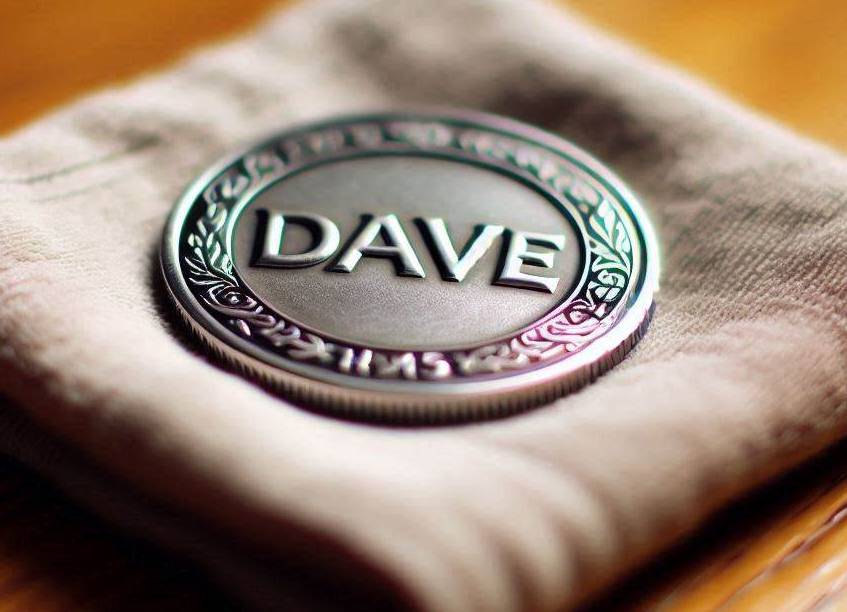

# DaveCoin (DAVE)

Live **DaveCoin on [pump.fun](https://pump.fun/coin/jryXyEe7BPFxKze8bLJJSqbTWw464qgop8JfZUSpump)** + demo site + **treasury** (deposit / withdraw) so [Dave’s Palace](https://github.com/kyniops/Dave-s-Palace) can integrate later.



| | |
|--|--|
| Name | DaveCoin |
| Symbol | DAVE |
| **Live mint** | `jryXyEe7BPFxKze8bLJJSqbTWw464qgop8JfZUSpump` |
| Decimals | **6** |
| Buy | [pump.fun](https://pump.fun/coin/jryXyEe7BPFxKze8bLJJSqbTWw464qgop8JfZUSpump) |
| Repo | [thedavegoat-art/davecoin](https://github.com/thedavegoat-art/davecoin) |

## Structure

```
davecoin/
├── assets/
├── docs/
│   ├── PUMP.md           # canonical live token
│   ├── ECONOMICS.md
│   ├── INTEGRATION.md    # Palace bridge API
│   ├── POOL.md           # optional post-graduation Raydium
│   └── tokenomics.md
├── token/                # optional Devnet lab mint scripts
├── treasury/             # custodial ledger API
└── web/                  # Next.js UI (Buy → pump.fun)
```

## Quick start (site)

```bash
npm install
cp web/.env.example web/.env.local
npm run dev
```

Open [http://localhost:3000](http://localhost:3000) → **Buy DAVE** opens pump.fun.  
Phantom must be on **Mainnet**.

## Treasury (Palace bridge)

```bash
cp treasury/.env.example treasury/.env
npm run treasury:dev
```

Fund the treasury wallet with live DAVE (bought on pump), then deposit/withdraw from the site.

### Pour kyniops (Dave’s Palace)

Pack prêt à coller :

→ [`integrations/daves-palace/`](./integrations/daves-palace/)  
→ Brief FR : [`docs/PALACE_BRIEF_FR.md`](./docs/PALACE_BRIEF_FR.md)  
→ API : [`docs/INTEGRATION.md`](./docs/INTEGRATION.md)

## Lab Devnet mint (optional)

`npm run token:create` still works for a **separate** 9-decimal test mint.  
Do **not** confuse it with the live pump mint. Details: [`docs/PUMP.md`](./docs/PUMP.md).

## Security

- Never commit `token/.keys/`, `treasury/.keys/`, `treasury/data/`, or secrets  
- Treasury secret key stays on a private server  
- Not financial advice — meme / game bridge token
